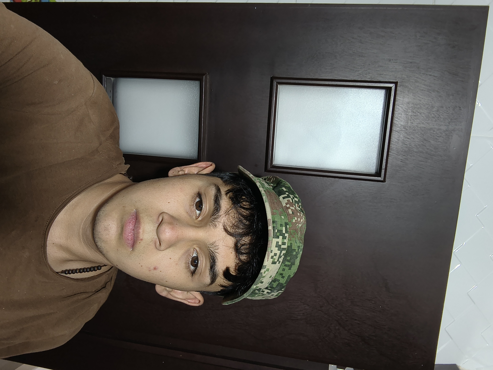

#  Hola Soy Juan Mora

  

Estudiante de Ingeniería de Sistemas en la Universidad Autónoma de Bucaramanga (UNAB).

## Sobre mí

Soy un estudiante apasionado por la tecnología, la programación y el desarrollo de software. Me interesa aprender nuevas herramientas, resolver problemas y crear proyectos que aporten soluciones útiles e innovadoras.

- Me interesa el desarrollo de aplicaciones y software.
- Trabajo con tecnologías de desarrollo móvil.
- Me gusta aprender sobre programación, inteligencia artificial y arquitectura de software.
- 🛠Disfruto enfrentar retos y mejorar mis habilidades técnicas.
- Siempre estoy buscando nuevas oportunidades para aprender y crecer como desarrollador.

## Tecnologías y herramientas

- **Lenguajes:** Java, Python y MATLAB.
- **Desarrollo móvil:** Android Studio y Jetpack Compose.
- **Control de versiones:** Git y GitHub.
- **Bases de datos y servicios:** Firebase.
- **Otros intereses:** Inteligencia artificial, diseño de software y desarrollo de aplicaciones.

## Objetivos

Mi objetivo es seguir fortaleciendo mis conocimientos en ingeniería de software, desarrollar proyectos cada vez más completos y convertirme en un profesional capaz de crear soluciones tecnológicas eficientes e innovadoras.

## Conecta conmigo

- GitHub: [@Juanjx77](https://github.com/Juanjx77)

---

⭐ *Aprendiendo, programando y mejorando un poco cada día.*
